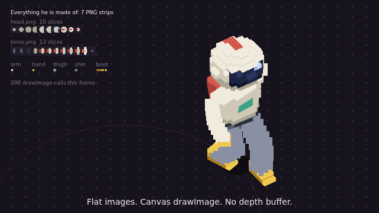
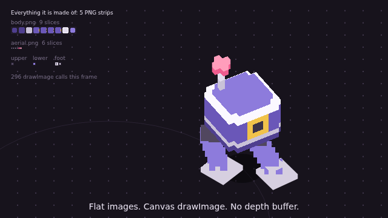
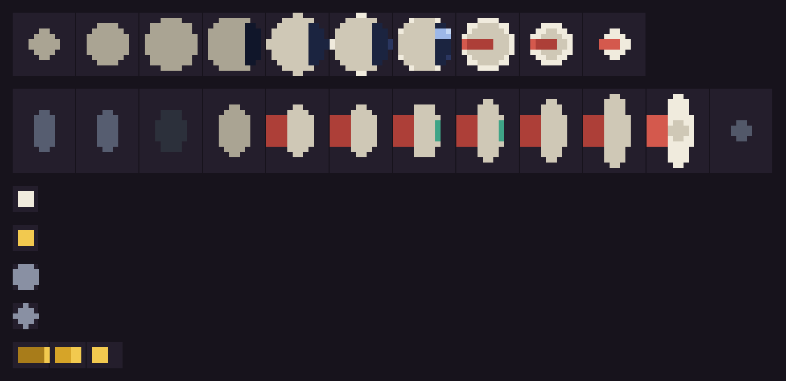

# Sprite stack animation



A starter kit for sprite-stacked characters that walk, on a plain 2D canvas. A character is a handful of small PNG
strips; every slice on screen is one `drawImage` call; the legs are driven by a distance-based gait with planted
feet and two-bone IK. The whole character lives in one file, so you can swap in your own.

Open `index.html` in a browser. It runs from the file system or any static server; there is nothing to install.



The robot is the same code with a different `character.js` (`index.html?char=robot`).

## Make your own

1. **Get the kit.** Clone or download this repository. To start from the robot instead of the explorer, copy
   `examples/robot/character.js` over `character.js`.
2. **Describe the character** in `character.js`. It has six sections:

   | Section | What it holds |
   | --- | --- |
   | `materials` | colours, three tones each: side in shade, side, top |
   | `parts` | the stacks: size in art pixels, number of layers, and a function saying what fills each point |
   | `rig` | bone lengths, hip width and height, stride, how long a foot stays down, swing height, bob, twist, arms or none, which way the knees bend |
   | `view` | screen pixels per art pixel, camera angle, shadow size |
   | `walk` | how many strides one lap of the demo circle is, and how many frames |
   | `draw` | which stack goes on which joint |

3. **Build the strips:** `node tools/build-art.js` (Node, no packages to install). This writes `art/*.png`,
   `art/parts.js` and `art/sheet.png`, an enlarged view of every strip.
4. **Open `index.html`** and look. `?view=stack`, `?view=spread`, `?view=rig` and `?view=bones` hold one view;
   `?wide` shows the whole circle.
5. **Tune the walk.** `rig`, `view`, `walk` and `draw` are read by the page directly, so change a number and
   reload; only `materials` and `parts` need a rebuild.

   | If | Change |
   | --- | --- |
   | the legs look stiff and straight | lower `standHip`, or lengthen `thigh` and `shin` |
   | the steps are too short or too long | `stride` (ground covered by two steps) |
   | it shuffles | raise `lift` |
   | it should run, not walk | `duty` under 0.5 and a longer `stride` |
   | it glides without weight | raise `bob` and `twist` |
   | knees bend the wrong way | `kneeHint: -1` |
   | it walks too fast or slow in the demo | `walk.strides` (more strides per lap is faster) |

6. **Capture a GIF:** see [Making a GIF](#making-a-gif).

To keep several characters side by side, put each in `examples/<name>/character.js`, build it with
`node tools/build-art.js examples/<name>` and open `index.html?char=<name>`.

### Drawing the strips by hand

You do not need the functions. Any pixel editor will do.

**Strip format.** One PNG per part, with a transparent background:

- the slices sit side by side in one row, **bottom slice first** (leftmost is the lowest layer);
- every cell is the same size;
- the stack turns around the **centre of the cell**, so keep the part centred;
- the part faces **right** (+x is forward) when seen from above.



To use a hand-drawn strip, list the part in `character.js` without a function:

```js
{ name: 'head', w: 12, h: 12, layers: 10 }   // cell 12 wide, 12 tall, 10 cells: art/head.png must be 120x12
```

`build-art.js` leaves such a PNG alone and only records its cell size. That record is `art/parts.js`, which you can
also write yourself:

```js
window.PARTS = [{ "name": "head", "cw": 12, "ch": 12, "n": 10 }, { "name": "torso", "cw": 12, "ch": 16, "n": 12 }];
```

Shade as you draw: pixels that have nothing above them are tops and should be lighter; the rest are only ever seen
as the side of a layer.

## How it works

**Drawing** (`js/stack.js`). Each slice is drawn with `translate`, `scale(1, ys)` to flatten the ground,
`rotate` for the facing, then `drawImage`. A slice sits a little further up the screen than the one below it and
is repeated a few rows so a layer has thickness. All slices of all parts go into one queue, sorted by height and
drawn bottom to top, so nearer and higher things cover what is behind them without any depth test.

**The walk** (`js/rig.js`).

- The step clock runs on distance covered, not time, so feet never slide.
- A planted foot is a fixed point in the world; the body travels over it. A swinging foot eases to where it
  will be needed next.
- The knee is solved every frame from hip and foot with the law of cosines (analytic two-bone IK). The elbows
  use the same function.
- Hip height is solved so the planted leg can always reach. The hips bob twice a stride and turn with the
  leading leg; the shoulders turn the other way.

**The loop** (`js/demo.js`). The character walks a circle sized to be a whole number of strides, so the last
frame leads into the first. The page is a function of the frame number, which makes capture repeatable.

## Is this voxels?

No. The inputs are flat images and the only drawing call is `drawImage`. There is no depth buffer, no mesh and
no shader. Repeating a slice a few rows to fill a layer is the same flat image drawn again.

The functions in `character.js` are just a way to author slices; the output is ordinary PNG strips, and strips
painted by hand work exactly the same.

In the spread view the layers are pulled apart to show them. The gaps, the thinner slices and the dark edge under
each one are for show and are not part of normal drawing.

## Making a GIF

Needs Python with Playwright (`pip install playwright`, `playwright install chromium`) and ffmpeg.

```sh
sh tools/encode.sh                        # this folder's character: out/walk.gif and out/walk.mp4
sh tools/encode.sh robot "&char=robot"    # an example: out/robot.gif and out/robot.mp4
```

This steps the page frame by frame in headless Chromium and writes a 640x360, 30 fps GIF and a 1920x1080, 60 fps
MP4. Nothing is recorded in real time, so the result is identical on every run.

## Use it as an agent skill

`skills/animated-sprite-stacks/` is a standard skill folder: a `SKILL.md` with the technique and a step-by-step
"make a new character" workflow, plus `template/`, a full copy of this kit. Any coding agent that reads `SKILL.md`
skills can use it to build a character from a description, with no access to this repository.

```sh
git clone https://github.com/loktar00/sprite-stack-animation
mkdir -p ~/.claude/skills
cp -r sprite-stack-animation/skills/animated-sprite-stacks ~/.claude/skills/
```

Use your agent's own skills folder if it is somewhere else. Then ask for something like "make me a sprite-stacked
walking knight and capture a GIF".

After changing the kit, `node tools/sync-skill.js` copies it into the skill's `template/` again.

## Using the pieces in your own page

```html
<script src="js/stack.js"></script>
<script src="js/rig.js"></script>
<script>
  SpriteStack.load([{ name: 'torso', cw: 12, ch: 16, n: 12 }], 'art/').then(function (art) {
    const ctx = document.querySelector('canvas').getContext('2d');
    const r = SpriteStack.createRenderer(ctx, { scale: 6, pitch: 42 * Math.PI / 180 });
    r.begin(160, 140);                 // where the world's origin lands on the canvas
    r.stack(art.torso, 0, 0, 0, 0.6);  // stack, x, y, z, angle
    r.flush();                         // draw everything queued, lowest first
  });
</script>
```

`Rig.createWalker(config)`, then `Rig.step(walker, x, y, heading, dt)` once per fixed step, then
`Rig.pose(walker)` gives hips, knees, ankles, and shoulders, elbows and hands if it has arms, as `[x, y, z]`.

## Files

| Path | What |
| --- | --- |
| `character.js` | the character: materials, parts, rig, view, walk, draw |
| `examples/robot/` | a second character |
| `index.html` | the demo page |
| `js/stack.js` | sprite stacking on a 2D canvas |
| `js/rig.js` | gait, planted feet, two-bone IK |
| `js/demo.js` | the views, the skeleton overlay, the frame clock |
| `art/` | the built strips, `parts.js` and `sheet.png` |
| `tools/build-art.js` | strips from `character.js` |
| `tools/capture.py`, `tools/encode.sh` | frames, GIF and MP4 |
| `tools/sync-skill.js` | copies the kit into the skill's `template/` |
| `skills/animated-sprite-stacks/` | the skill |

## Licence

MIT. See `LICENSE`.
