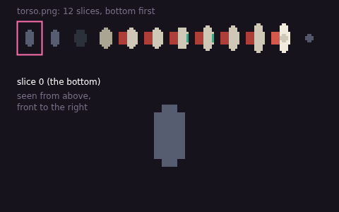
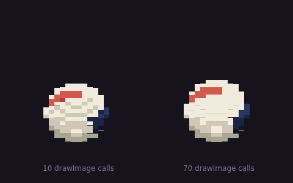
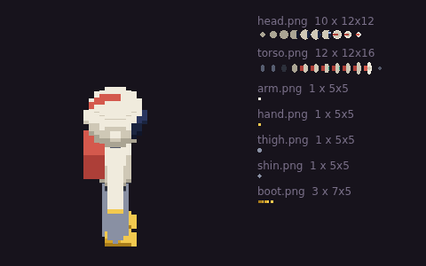
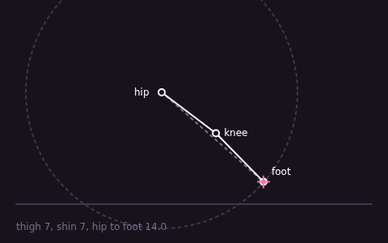
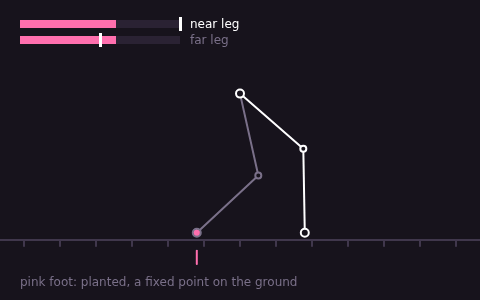
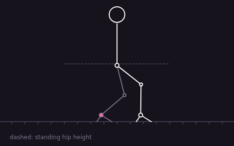
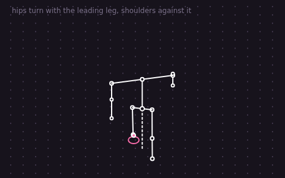
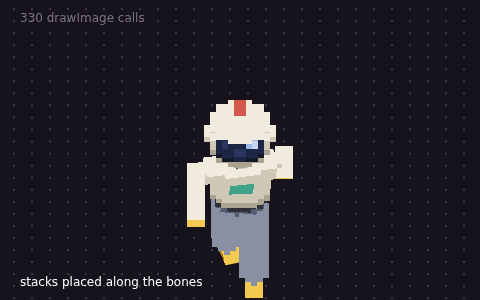
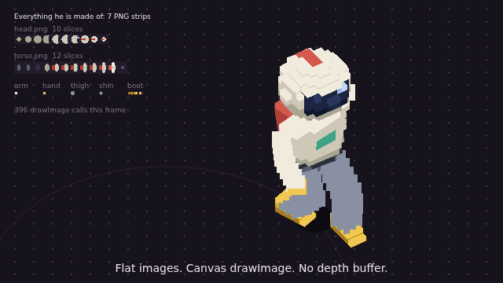

# Tutorial: a walking sprite stack from scratch

Nine steps, from one flat image to a looping GIF of a rigged, walking character. Every step is a page you can
open and change: `docs/steps/01.html` to `09.html`. They run from the file system; no build, no server.

The steps build the explorer that ships in this repository. The code in each section is the code of that page.

| | Step | You get |
| --- | --- | --- |
| 1 | [One slice](#1-one-slice) | a PNG cell drawn with `drawImage` |
| 2 | [A stack](#2-a-stack) | layers, squash, rotation, thickness |
| 3 | [Parts](#3-parts) | a figure from seven strips |
| 4 | [A knee](#4-a-knee-two-bone-ik) | two-bone IK |
| 5 | [Planted feet](#5-planted-feet-and-the-step-clock) | a step clock driven by distance |
| 6 | [Lift, bob, hip height](#6-lift-bob-and-hip-height) | a walk with weight |
| 7 | [Three dimensions and arms](#7-three-dimensions-twist-and-arms) | the full rig as a skeleton |
| 8 | [Put the stacks on](#8-put-the-stacks-on-the-bones) | the character, skeleton overlay, spread view |
| 9 | [Loop and capture](#9-loop-and-capture) | a seamless GIF |

Words used throughout: an *art pixel* is one pixel of a strip. World positions are in art pixels: `x` and `y`
on the ground, `z` up.

## 1. One slice



A part of the character is stored as a **strip**: one PNG with the part's horizontal slices side by side, the
bottom slice first. Each slice is the part seen from straight above at one height, facing right.

Drawing one slice is cutting one cell out of the strip:

```js
const strip = new Image(); strip.src = '../../art/torso.png';
const CW = 12, CH = 16;                                  // the size of one cell

ctx.imageSmoothingEnabled = false;                       // keep the pixels square
ctx.drawImage(strip, i * CW, 0, CW, CH,                  // cell i of the strip...
              174, 104, CW * 11, CH * 11);               // ...drawn 11 times its size
```

That call is the whole technique. Everything after this is deciding where to make it.

Open [`steps/01.html`](steps/01.html).

## 2. A stack



Draw the slices bottom to top, each one a little further up the screen, and the pile reads as a solid object.
Three things turn a pile of pictures into something you can look around:

- **the squash**: the ground is seen at an angle, so everything on it is flattened vertically: `scale(1, ys)`;
- **the facing**: `rotate(angle)` turns the slice, and so the object;
- **thickness**: a layer is several screen rows tall but a slice is flat. Repeat each slice once per row, or
  every layer is a pixel thin (the left figure).

```js
const SCALE = 9;                                   // screen pixels per art pixel
const PITCH = 42 * Math.PI / 180;                  // the camera angle above the ground
const ys = Math.sin(PITCH);                        // how flat the ground looks
const zk = SCALE * Math.cos(PITCH);                // screen rows per layer of height

function drawStack(ctx, cx, cy, angle) {
  for (let i = 0; i < N; i++) {                    // bottom slice first: later slices cover earlier ones
    for (let k = 0; k < Math.ceil(zk); k++) {      // repeat the slice to fill its layer
      ctx.setTransform(1, 0, 0, 1, cx, cy - Math.round(i * zk) - k);
      ctx.scale(1, ys);
      ctx.rotate(angle);
      ctx.drawImage(strip, i * CW, 0, CW, CH, -CW * SCALE / 2, -CH * SCALE / 2, CW * SCALE, CH * SCALE);
    }
  }
  ctx.setTransform(1, 0, 0, 1, 0, 0);
}
```

The slice is drawn centred on the origin, so the stack turns around the middle of its cell. That is why parts are
drawn centred in their cells.

Open [`steps/02.html`](steps/02.html) and change `PITCH`: 90 degrees is straight down, small angles are nearly
side on.

## 3. Parts



One stack cannot bend. A character is several: here a head and a torso, a boot, and four small one-slice discs
for arm, hand, thigh and shin. A limb is its disc repeated along a straight line.

Two parts can overlap on screen (an arm in front of the chest), so they cannot be drawn one after the other.
From here on the pages use [`js/stack.js`](../js/stack.js), which is step 2 plus one queue: every slice row of
every part is queued with its height, sorted, and drawn lowest first.

```js
const R = SpriteStack.createRenderer(ctx, { scale: 6, pitch: 42 * Math.PI / 180 });

R.begin(130, 262);                                   // where the world's origin lands on the canvas
R.stack(art.boot, x, y, 0, angle);                   // a stack: x, y, height of its underside, angle
R.limb(art.shin, [x, y, 1.5], [x, y, 7.4], 5);       // a limb: one disc, 5 copies along a line
R.limb(art.thigh, [x, y, 7.4], [x, y, 13.2], 5);
R.stack(art.torso, 0, 0, 12.2, angle);
R.stack(art.head, 0, 0, 24.2, angle);
R.flush();                                           // sort by height, draw
```

The strips are loaded with `SpriteStack.load(PARTS, 'art/')`. `PARTS` lists each strip's cell size and slice
count, and lives in `art/parts.js`:

```js
window.PARTS = [{ "name": "head", "cw": 12, "ch": 12, "n": 10 }, { "name": "torso", "cw": 12, "ch": 16, "n": 12 }, ...];
```

Where do the strips come from? Draw them in a pixel editor, or describe each part as a function of position and
let `tools/build-art.js` write them (that is what `character.js` does; see the README).

Open [`steps/03.html`](steps/03.html). The figure stands stiff: the positions are typed in. Next, a rig works
them out.

## 4. A knee: two-bone IK



A leg is two bones of fixed length. If you know where the **hip** is and where the **foot** should be, there is
only one place the knee can be (and its mirror image). No animation data is needed: the knee is solved.

Hip, knee and foot form a triangle with sides `a` (thigh), `b` (shin) and `d` (hip to foot). The law of cosines
gives the angle at the hip:

```
cosA = (a*a + d*d - b*b) / (2*a*d)
```

The knee is then `a*cosA` along the hip-to-foot line and `a*sinA` out to the side. Which side is the **hint**:
forward for a human knee, backward for a bird's or an elbow.

```js
// a point is [x, z]: forward and up
function solveKnee(hip, foot, a, b, hint) {
  let dx = foot[0] - hip[0], dz = foot[1] - hip[1];
  const len = Math.hypot(dx, dz) || 1e-6; dx /= len; dz /= len;
  const d = Math.min(Math.max(len, Math.abs(a - b) + 0.001), a + b - 0.001);   // too far to reach: the leg is straight
  const cosA = (a * a + d * d - b * b) / (2 * a * d), sinA = Math.sqrt(Math.max(0, 1 - cosA * cosA));
  let px = -dz, pz = dx;                                                      // at right angles to the hip-to-foot line...
  if (px * hint[0] + pz * hint[1] < 0) { px = -px; pz = -pz; }                // ...on the side the hint points to
  return [hip[0] + dx * a * cosA + px * a * sinA, hip[1] + dz * a * cosA + pz * a * sinA];
}
```

Open [`steps/04.html`](steps/04.html) and move the mouse over the picture: the foot follows the pointer and the
knee follows the sum. Pull the pointer outside the dashed circle and the leg goes straight. Change the hint to
`[-1, 0]` for a backward knee.

## 5. Planted feet and the step clock



Now the feet need somewhere to be. Two rules make a walk:

1. **The clock runs on distance, not time.** One number, `phase`, goes from 0 to 1 over one stride (two steps).
   It advances by `distance moved / stride length`. Stop the body and the legs stop; nothing can slide.
2. **A planted foot is a fixed point on the ground.** Each leg is planted for the first part of its cycle
   (`DUTY`) and swings for the rest. The two legs are half a cycle apart.

```js
const STRIDE = 18, DUTY = 0.6, STANCE = DUTY * STRIDE;       // STANCE: ground the body covers while one foot is down

function walk(dist) {
  body += dist;
  phase = (phase + dist / STRIDE) % 1;                       // the step clock
  for (let i = 0; i < 2; i++) {
    const foot = feet[i], p = (phase + i * 0.5) % 1;         // this leg's own clock
    if (p < DUTY) {
      if (!foot.planted) { foot.planted = true; foot.x = body + STANCE / 2 - p * STRIDE; }   // touchdown
      // planted: foot.x is not touched. The body moves over it.
    } else {
      if (foot.planted) { foot.planted = false; foot.from = foot.x; }
      const u = (p - DUTY) / (1 - DUTY);                     // 0 at lift-off, 1 at touchdown
      const land = body + (1 - p) * STRIDE + STANCE / 2;      // where the hip will be at touchdown, plus half a stance
      foot.x = foot.from + (land - foot.from) * ease(u);
    }
  }
}
```

A foot touches down **half a stance ahead of the hip**, so the hip passes over it exactly mid-stance and leaves it
half a stance behind. While swinging, the foot eases from where it lifted to where it must land. The landing
point is recomputed every frame from where the hip will be, so the foot always arrives on time.

The knee comes from step 4, every frame, from the hip and the foot.

Open [`steps/05.html`](steps/05.html). Watch a pink foot against the ground marks: it does not move. Try
`DUTY = 0.4`: less than half the cycle on the ground means both feet are in the air between steps, which is a run.

## 6. Lift, bob and hip height



Three small additions give the walk weight.

**Lift.** The swing is an arc, not a slide:

```js
foot.z = LIFT * Math.sin(Math.PI * u);
```

**Hip height is solved, not animated.** A planted foot far from under the hip needs a lower hip, or the leg
would have to stretch. Take the furthest planted foot, and let the hip be as high as standing allows but never
out of that foot's reach:

```js
const reach = THIGH + SHIN - 0.3;
const most = ANKLE + Math.sqrt(Math.max(1, reach * reach - far * far));   // Pythagoras: far along the ground, most up
hipZ += (Math.min(STAND, most) - hipZ) * 0.23;                            // ease towards it
if (hipZ > most) hipZ = most;
```

**Bob.** The hips dip twice a stride, once per footfall:

```js
const pelvisZ = hipZ - BOB * Math.cos(2 * TAU * phase);
```

Open [`steps/06.html`](steps/06.html). Set `STAND` higher than the legs can reach (15) and the hip-height solve
pulls it back down; set `LIFT` to 0 to get the shuffle back.

## 7. Three dimensions, twist and arms



The side view had one ground coordinate. The real thing has two, and that is [`js/rig.js`](../js/rig.js): the
same clock, the same planted feet, the same solver with a third coordinate. What it adds:

- the two hips sit either side of the body, `hipHalf` apart from the middle;
- **twist**: the hip line turns a little with the leading leg, `twist * cos(2 * pi * phase)`, and the shoulder line
  turns the other way;
- a planted foot keeps the angle it landed at, and a swinging one turns towards the heading;
- **arms**: a shoulder, a hand that swings against the leg on its side, and an elbow from the *same* two-bone
  solver with the hint pointing backwards.

```js
const walker = Rig.createWalker(CHARACTER.rig);      // bone lengths, stride, duty, lift, bob, twist...
Rig.place(walker, x, y, heading);                    // stand it somewhere

// once per fixed time step: tell it where the body is now
Rig.step(walker, x, y, heading, 1 / 60);

const P = Rig.pose(walker);
// P.pelvis, P.top                      [x, y, z]
// P.legs[i]: hip, knee, ankle, sole    and rot, planted
// P.arms[i]: shoulder, elbow, hand
// P.hipsAngle, P.shouldersAngle, P.heading
```

The rig does no drawing. It only returns joints, so the skeleton here and the stacks in the next step read the
same numbers and cannot disagree.

Open [`steps/07.html`](steps/07.html). The numbers come from `character.js`; change `rig.twist` or
`rig.armSwing` there and reload.

## 8. Put the stacks on the bones



Each frame: pose the rig, queue every stack at its joints, flush. This is the `draw` function in
[`character.js`](../character.js):

```js
draw: function (R, art, P) {
  for (let i = 0; i < 2; i++) {
    const L = P.legs[i], A = P.arms[i];
    R.stack(art.boot, L.sole[0], L.sole[1], L.sole[2], L.rot);          // a boot on each sole, at the foot's own angle
    R.limb(art.shin, L.ankle, L.knee, 5); R.limb(art.thigh, L.knee, L.hip, 5);
    R.limb(art.arm, A.shoulder, A.elbow, 4); R.limb(art.arm, A.elbow, A.hand, 4);
    R.limb(art.hand, A.hand, A.hand, 1);
  }
  // the torso: every slice has its own angle, from the hips' at the bottom to the shoulders' at the top
  const T = art.torso, z0 = P.pelvis[2] - 1;
  for (let i = 0; i < T.n; i++) {
    const t = Math.min(1, i / (T.n - 3));
    R.slice(T, i, P.x, P.y, z0 + i, P.hipsAngle + (P.shouldersAngle - P.hipsAngle) * t, 1);
  }
  R.stack(art.head, P.x, P.y, z0 + T.n, P.heading);
}
```

Three details matter:

- **The torso twists for free.** Its slices are separate images, so each can have its own angle.
- **Limb discs sit half a layer under the bone.** A slice is a layer thick and is drawn upward from its height,
  so `R.limb` places each disc at `z - 0.5`. Then the bone runs through the middle of the limb.
- **The skeleton overlay** is the same joints passed through the renderer's `project(x, y, z)` and joined with
  lines. If the overlay and the art ever disagree, the drawing is wrong, not the rig.

The **spread view** is `R.begin(ox, oy, spread)`: the height step between layers is multiplied and each slice
thinned, so every flat layer is visible. Layers of one colour would still merge, so each slice also gets a dark
copy of itself just underneath. None of that is part of normal drawing.

Open [`steps/08.html`](steps/08.html).

## 9. Loop and capture



**No seam.** A loop repeats cleanly only if the walk is in the same state at the end as at the start. Walk a
circle whose length is a whole number of strides:

```js
const LAP = 540, STRIDES = 10;                                                   // frames per lap, strides per lap
const RADIUS = STRIDES * stride / (LAP * 2 * Math.sin(Math.PI / LAP));           // LAP chords add up to STRIDES strides
```

Walk a few laps first so the start-up is forgotten, and keep the poses of the last one:

```js
for (let f = 1; f <= LAP * 4; f++) {
  const p = where(f); Rig.step(walker, p[0], p[1], p[2], 1 / 60);
  if (f >= LAP * 3) FRAMES.push(Rig.pose(walker));
}
```

Check it: the pose at the start of the kept lap and the pose one lap later should differ only by rounding error
(the page prints it: about 1e-13).

**A picture per frame number.** With the poses in an array, drawing frame `f` reads nothing but `f`. The page
exposes `demo.seek(f)`; playing live is just asking for `seconds * 60`.

Open [`steps/09.html`](steps/09.html). The full demo, [`index.html`](../index.html), is this plus the view
changes and the panel.

**Capture.** Never record the screen in real time. Ask for the frames one by one in headless Chromium, then
encode them:

```sh
pip install playwright && playwright install chromium     # once; ffmpeg is needed too
sh tools/encode.sh                                         # out/walk.gif (640x360, 30 fps) and out/walk.mp4 (1080p, 60 fps)
```

Inside, `tools/capture.py` does `demo.seek(f)` and a screenshot per frame, and ffmpeg builds the GIF with a
palette made from the frames and no dithering, which keeps flat pixel art flat and the file small:

```sh
ffmpeg -framerate 30 -i out/walk-gif/%04d.png \
  -vf "split[a][b];[a]palettegen=max_colors=256:stats_mode=full[p];[b][p]paletteuse=dither=none:diff_mode=rectangle" \
  -loop 0 out/walk.gif
```

The pictures in this tutorial were made the same way from the step pages: `sh tools/tutorial-images.sh`.

## Now make your own

Everything character-specific is in [`character.js`](../character.js): materials, parts, rig numbers and the
`draw` function from step 8. Change it, run `node tools/build-art.js`, reload. The README's "Make your own"
section has the checklist and a table of what to tune, and `examples/robot/` shows how different a second
character can be with no change to the code of steps 1 to 9.
